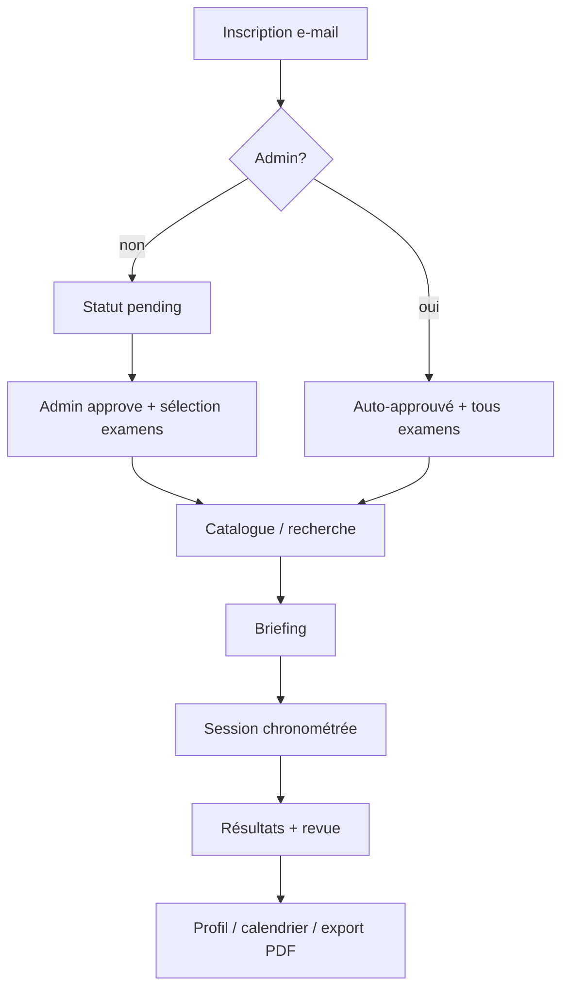

# Examinator — Documentation technique

Documentation de développement, d’architecture et de mise en service du logiciel **Examinator** (simulateur d’examens de certification IT).

| Élément | Valeur |
|--------|--------|
| Racine projet | `/opt/exam-simulator` |
| Nom produit | Examinator |
| Stack | FastAPI · Jinja2 · SQLAlchemy · SQLite · uvicorn |
| Port HTTP | `8000` |
| Service systemd | `exam-simulator.service` |

---

## 1. Objectif du logiciel

Examinator est une plateforme web d’entraînement aux examens de certification IT (Microsoft, CompTIA, sujets Examinator). Elle permet de :

- s’inscrire par e-mail (sans mot de passe) ;
- obtenir une validation administrateur et des accès par examen ;
- parcourir un catalogue et rechercher des simulateurs ;
- passer des sessions chronométrées (~50 questions mélangées) ;
- consulter les résultats par section et exporter un PDF ;
- télécharger un mode d’emploi PDF multilingue (FR, EN, IT, ES, DE).

L’**interface utilisateur** de l’application (menus, boutons, écrans d’examen) est en **anglais uniquement**. Les manuels PDF sont fournis en plusieurs langues.

---

## 2. Architecture

```
Navigateur
    │
    ▼
[nginx optionnel] ──► uvicorn :8000 ──► FastAPI (app.main:app)
                              │
              ┌───────────────┼───────────────┐
              ▼               ▼               ▼
         routes/web      routes/admin    routes/api
              │               │               │
              └───────────────┼───────────────┘
                              ▼
                         services/*
                              │
                              ▼
                    SQLAlchemy + SQLite
                    data/exams.db
                              │
              ┌───────────────┴───────────────┐
              ▼                               ▼
        templates/*.html              static/ (css, js, pdf, img)
```

| Couche | Rôle |
|--------|------|
| `app/main.py` | Application FastAPI, montage static, routers, migration schéma au démarrage |
| `app/routes/` | Endpoints HTTP (HTML + JSON) |
| `app/services/` | Logique métier |
| `app/models/models.py` | Modèle ORM |
| `app/database.py` | Engine SQLite synchrone, `SessionLocal`, `get_db` |
| `app/config.py` | Paramètres (`Settings` / variables d’environnement) |
| `app/templating.py` | Jinja2 + globals |
| `app/data/` | Catalogues statiques (Microsoft, CompTIA, topics) |
| `app/templates/` + `app/static/` | UI serveur |

Pas de Docker, pas d’Alembic, pas de `pyproject.toml` : installation classique venv + systemd.

---

## 3. Arborescence du projet

```
/opt/exam-simulator/
├── README.md                          # Démarrage rapide
├── docs/DOCUMENTATION_TECHNIQUE.md    # Ce document
├── requirements.txt
├── .env                               # Optionnel (non versionné)
├── venv/                              # Environnement Python 3.13
├── data/
│   └── exams.db                       # Base SQLite (créée à l’usage)
├── app/
│   ├── main.py
│   ├── config.py
│   ├── database.py
│   ├── templating.py
│   ├── models/models.py
│   ├── routes/
│   │   ├── web.py                     # Pages utilisateur
│   │   ├── admin.py                   # Administration HTML
│   │   └── api.py                     # API JSON
│   ├── services/                      # Voir §9
│   ├── data/                          # Catalogues statiques
│   ├── templates/
│   └── static/
│       ├── css/style.css
│       ├── js/{sidebar,session}.js
│       ├── img/                       # logo, favicon, SVG vendors
│       └── docs/
│           ├── manuals/               # PDF modes d’emploi versionnés
│           └── screenshots/           # Captures pour les manuels
├── scripts/                           # Ops, seed, PDF, qualité
├── tests/                             # pytest
├── deploy/
│   ├── exam-simulator.service
│   ├── install-systemd.sh
│   └── nginx-exam-simulator.conf
└── branding/                          # Sources logo / favicon
```

---

## 4. Prérequis

### 4.1 Système

| Prérequis | Détail |
|-----------|--------|
| OS | Linux (cible : conteneur Proxmox LXC) |
| Python | **3.13** (`/usr/bin/python3.13`) |
| Venv | `/opt/exam-simulator/venv` |
| `PYTHONPATH` | `/opt/exam-simulator` (obligatoire) |
| Port | `8000` en écoute `0.0.0.0` |
| systemd | Unité `exam-simulator.service` |

### 4.2 Paquets système recommandés

```bash
# Polices pour la génération des modes d’emploi PDF (ReportLab + DejaVu)
sudo apt-get install -y fonts-dejavu-core

# Optionnel : reverse proxy
sudo apt-get install -y nginx
```

Polices attendues :

- `/usr/share/fonts/truetype/dejavu/DejaVuSans.ttf`
- `/usr/share/fonts/truetype/dejavu/DejaVuSans-Bold.ttf`

### 4.3 Assets branding

```bash
/opt/exam-simulator/scripts/install_branding.sh
```

Attendus sous `app/static/img/` : `logo.png`, `favicon.png`.

### 4.4 Outils optionnels (déjà présents dans le venv de prod, hors `requirements.txt`)

| Outil | Usage |
|-------|--------|
| `pytest` | Tests |
| `pdfplumber` | Sync credentials depuis PDF poster |
| `playwright` | Captures d’écran des manuels (`scripts/capture_manual_screenshots.py`) |
| `pymupdf` | Outillage PDF |

---

## 5. Dépendances Python

Fichier : `requirements.txt`

| Paquet | Rôle |
|--------|------|
| `fastapi` | Framework web / OpenAPI |
| `uvicorn` | Serveur ASGI |
| `sqlalchemy` | ORM + engine SQLite synchrone |
| `aiosqlite` | Déclaré ; **non utilisé** (engine sync) |
| `jinja2` | Templates HTML |
| `python-multipart` | Formulaires et uploads |
| `httpx` | Client HTTP (Learn, posters) |
| `beautifulsoup4` + `lxml` | Parsing HTML |
| `pydantic-settings` | Configuration |
| `email-validator` | Validation e-mail |
| `openpyxl` | Import / export Excel des banques de questions |
| `reportlab` | PDF manuels utilisateur + export résultats |

Installation :

```bash
cd /opt/exam-simulator
python3 -m venv venv
./venv/bin/pip install -r requirements.txt
```

---

## 6. Configuration

Fichier : `app/config.py`  
Fichier d’environnement optionnel : `/opt/exam-simulator/.env`

```python
class Settings(BaseSettings):
    app_name: str = "Examinator"
    database_url: str = "sqlite:////opt/exam-simulator/data/exams.db"
    secret_key: str = "change-me-in-production-use-env-var"
    questions_per_session: int = 50
    session_cookie: str = "certsim_user_id"
    admin_email: str = "michel@aguilera.ch"
```

| Variable d’env | Champ | Description |
|----------------|-------|-------------|
| `APP_NAME` | `app_name` | Nom affiché |
| `DATABASE_URL` | `database_url` | URL SQLAlchemy SQLite |
| `SECRET_KEY` | `secret_key` | **Défini mais non utilisé** (pas de cookie signé / JWT) |
| `QUESTIONS_PER_SESSION` | `questions_per_session` | Taille de session par défaut |
| `SESSION_COOKIE` | `session_cookie` | Nom du cookie de session |
| `ADMIN_EMAIL` | `admin_email` | E-mail admin (seul critère d’admin) |

Exemple `.env` :

```env
ADMIN_EMAIL=admin@example.com
DATABASE_URL=sqlite:////opt/exam-simulator/data/exams.db
QUESTIONS_PER_SESSION=50
```

---

## 7. Base de données

- **Engine** : `app/database.py` — SQLite synchrone, `check_same_thread=False`
- **Fichier par défaut** : `/opt/exam-simulator/data/exams.db`
- **Migrations** : pas d’Alembic. Au démarrage, `migrate_schema()` dans `app/main.py` :
  1. `create_all` si tables absentes ;
  2. `ALTER TABLE` additifs pour colonnes manquantes ;
  3. backfills (dates de pool, accès utilisateurs legacy).

### Tables principales (`app/models/models.py`)

| Table | Rôle |
|-------|------|
| `certification_families` | Familles / vendors (AZ, SC, CompTIA, topics…) |
| `users` | Identité, `status` (`pending` / `approved` / `rejected`) |
| `exams` | Métadonnées examen, durée, score, pool |
| `sections` | Domaines de compétences + poids |
| `questions` | Énoncés, type, fingerprint, source |
| `answer_options` | Options A–F, `is_correct` |
| `exam_sessions` | Tentatives (en cours / terminées / expirées) |
| `session_questions` | Jeu ordonné de questions pour une tentative |
| `session_answers` | Réponses sélectionnées |
| `exam_sources` | URLs sources liées |
| `import_logs` | Journal d’imports |
| `user_exam_access` | Accès utilisateur ↔ examen |

**Enums** : `QuestionType` (`single` / `multiple`), `SessionStatus`, `UserStatus`.

**Score de réussite** : un succès est typiquement évalué avec `score_percent >= passing_score / 10` (ex. `700` → 70 %).

---

## 8. Authentification et autorisations

### Mécanisme

- Cookie nommé `certsim_user_id` (configurable) contenant l’**id utilisateur en clair**.
- Durée : 365 jours.
- Posé à l’inscription / reconnexion e-mail ; effacé par `POST /logout`.
- **Pas de signature, pas de chiffrement** : la confiance repose sur le périmètre réseau / same-origin.

### Rôles (`app/services/auth.py`)

| Fonction | Comportement |
|----------|--------------|
| `get_current_user` | Lit le cookie → `User` |
| `is_admin` | `user.email.lower() == settings.admin_email.lower()` |
| `require_admin` | Redirige non-admin |
| `can_view_session` | Propriétaire **ou** admin |

### Cycle d’accès (`user_access_service`)

1. Nouvel utilisateur → `pending` (sauf e-mail admin → auto-approuvé + tous les examens).
2. Admin approuve avec une liste d’`exam_ids` → `approved` + lignes `user_exam_access`.
3. Rejet → `rejected`, accès effacés.
4. Catalogue / briefing / démarrage filtrés par `user_can_access_exam`.

---

## 9. Services métier

| Fichier | Responsabilité |
|---------|----------------|
| `exam_engine.py` | Démarrage session, tirage questions, réponses, expiration, scoring, revue |
| `exam_catalog.py` | Stats de pool, touch métadonnées, labels sources |
| `catalog_service.py` | Catalogue, vendors, familles, recherche, hubs programmes |
| `user_access_service.py` | Pending / approve / reject, grants d’examens |
| `auth.py` | Cookie et helpers admin |
| `import_service.py` | Import JSON, sync métadonnées Microsoft, stubs externes |
| `excel_import_service.py` | Templates et import `.xlsx` |
| `credentials_sync_service.py` | Sync familles/examens (poster PDF + catalogues) |
| `learn_skills_service.py` | Scraping poids Skills Measured (Microsoft Learn) |
| `question_quality.py` | Fingerprints, dédoublonnage, rapport qualité |
| `user_manual_service.py` | Manuels PDF multilingues (`MANUAL_VERSION`) |
| `results_pdf_service.py` | Export PDF des résultats par examen |
| `user_profile_service.py` | Agrégats profil + URLs d’export |
| `user_admin_service.py` | Gestion utilisateurs côté admin |
| `exam_admin_service.py` | Édition / suppression d’examens |
| `calendar_service.py` | Grille mensuelle des tentatives |
| `gravatar.py` | Avatars Gravatar |

---

## 10. Routes HTTP

### 10.1 Web (`app/routes/web.py`)

| Méthode | Chemin | Description |
|---------|--------|-------------|
| GET | `/` | Accueil |
| GET | `/catalog` | Catalogue |
| GET | `/catalog/search?q=` | Recherche globale |
| GET | `/catalog/vendor/{vendor_slug}` | Page vendor |
| GET | `/catalog/{family_code}` | Détail filière |
| GET | `/catalog/topics` | Topics Examinator |
| GET | `/help` | Choix langue du manuel |
| GET | `/help/manual/{lang}.pdf` | Téléchargement PDF (`fr\|en\|it\|es\|de`) |
| GET | `/profile` | Historique |
| GET | `/profile/exams/{exam_code}/export[.pdf]` | Export résultats |
| GET | `/calendar` | Calendrier des sessions |
| GET/POST | `/register` | Inscription / soft login |
| GET | `/exam/{exam_id}/briefing` | Briefing |
| POST | `/exam/{exam_id}/start` | Démarrer |
| GET | `/session/{session_id}` | Passer l’examen |
| POST | `/session/{session_id}/answer` | Répondre / soumettre |
| GET | `/session/{session_id}/results` | Résultats |
| POST | `/session/{session_id}/delete` | Supprimer une tentative |
| POST | `/logout` | Déconnexion |

Static : `GET /static/...` → `app/static/`.

### 10.2 Admin (`prefix=/admin`)

Tableau de bord, CRUD examens, imports JSON/Excel, sync Microsoft / sections / credentials, gestion utilisateurs (approve / reject / access / delete), consultation et export des résultats d’autres utilisateurs.

Accès réservé à l’e-mail `ADMIN_EMAIL`.

### 10.3 API (`prefix=/api`)

| Méthode | Chemin | Auth |
|---------|-------|------|
| GET | `/api/exams` | Public |
| POST | `/api/admin/sync/microsoft` | Admin |
| POST | `/api/admin/import/json?exam_code=` | Admin + fichier |
| POST | `/api/admin/sync/external/{source}` | Stub |
| GET | `/api/admin/import-logs` | Admin |

---

## 11. Interface (templates & static)

- Shell : `templates/base.html` (sidebar, recherche, Gravatar).
- Pages principales : `index`, `register`, `help`, `profile`, `calendar`, `briefing`, `session`, `results`.
- Catalogue : `templates/catalog/`.
- Admin : `templates/admin/`.
- CSS : `static/css/style.css` (cache-bust `?v=` dans `base.html`).
- JS : `sidebar.js`, `session.js`.

Thème de page : helper `page_section(path)` dans `templating.py`.

---

## 12. Installation et exécution

### 12.1 Script d’installation (recommandé)

Voir [`docs/INSTALLATION.md`](INSTALLATION.md) et `scripts/install_examinator.sh`.

```bash
git clone https://git.aguilera.ch/Aguilera_Lab/Examinator.git
cd Examinator
sudo ./scripts/install_examinator.sh --admin-email admin@example.com
```

### 12.2 Développement manuel

```bash
cd /opt/exam-simulator
python3 -m venv venv
./venv/bin/pip install -r requirements.txt
sudo apt-get install -y fonts-dejavu-core   # pour manuels PDF
./scripts/install_branding.sh               # si besoin

# Seed catalogue + pools de questions
PYTHONPATH=/opt/exam-simulator ./venv/bin/python scripts/seed_data.py

# Lancer le serveur
PYTHONPATH=/opt/exam-simulator ./venv/bin/uvicorn app.main:app --host 0.0.0.0 --port 8000
```

Ouvrir : <http://localhost:8000>

### 12.3 Production (systemd)

```bash
sudo INSTALL_DIR=/opt/exam-simulator /opt/exam-simulator/deploy/install-systemd.sh
systemctl status exam-simulator
systemctl restart exam-simulator
journalctl -u exam-simulator -f
```

Unité (`deploy/exam-simulator.service`) :

- `WorkingDirectory=/opt/exam-simulator`
- `Environment=PYTHONPATH=/opt/exam-simulator`
- `ExecStart=.../venv/bin/uvicorn app.main:app --host 0.0.0.0 --port 8000`
- `Restart=always`

Nginx optionnel : `deploy/nginx-exam-simulator.conf` (proxy vers le service local sur le port 8000).

---

## 13. Scripts opérationnels

| Script | Rôle |
|--------|------|
| `scripts/install_examinator.sh` | Installation complète depuis le dépôt (venv, `.env`, seed, systemd) |
| `scripts/seed_data.py` | Sync catalogue Microsoft + seed des pools |
| `scripts/quality_check.py` | Contrôle fingerprints / dédoublonnage (cron) |
| `scripts/repair_pools.py` | Dédoublonnage + recomplétion des pools courts |
| `scripts/clear_question_pools.py` | Désactive les questions actives |
| `scripts/sync_credentials.py` | Sync credentials / familles |
| `scripts/generate_excel_templates.py` | Génère les templates Excel |
| `scripts/generate_user_manuals.py` | Régénère tous les PDF manuels |
| `scripts/capture_manual_screenshots.py` | Captures Playwright (serveur + admin requis) |
| `scripts/install_branding.sh` | Installe logo / favicon |

Cron qualité suggéré :

```bash
0 3 * * * cd /opt/exam-simulator && PYTHONPATH=/opt/exam-simulator ./venv/bin/python scripts/quality_check.py
```

---

## 14. Tests

```bash
cd /opt/exam-simulator
PYTHONPATH=/opt/exam-simulator ./venv/bin/python -m pytest tests/ -q
```

| Fichier | Couverture |
|---------|------------|
| `test_excel_import.py` | Import Excel |
| `test_exam_admin.py` | Édition / suppression examens |
| `test_user_manual.py` | PDF manuels, `/help`, version |
| `test_results_pdf.py` | Export résultats |
| `test_admin_user_results.py` | Vue admin des résultats tiers |
| `test_catalog_search.py` | Recherche catalogue |
| `test_user_access.py` | Pending / approve / accès |
| `test_learn_skills.py` | Parsing Skills Measured |
| `test_question_quality.py` | Fingerprints / unicité |

Les tests utilisent souvent la base réelle via `SessionLocal` et `TestClient(app)`.

---

## 15. Import de questions

### Modèle Excel (dépôt)

- Fichier modèle : `docs/excel/examinator_question_bank_template.xlsx`
- Guide détaillé : `docs/excel/ALIMENTATION_QUESTIONS.md`

### JSON (API)

```bash
curl -X POST "http://localhost:8000/api/admin/import/json?exam_code=AZ-900" \
  -F "file=@questions.json"
```

Format attendu : tableau d’objets avec `section`, `question_type`, `text`, `explanation`, `external_id`, `options[{label,text,is_correct}]`.

### Excel

Via l’UI admin (`/admin/import/excel`) ou génération de templates :

```bash
PYTHONPATH=/opt/exam-simulator ./venv/bin/python scripts/generate_excel_templates.py
```

### Sources externes

Connecteurs `examtopics`, etc. : **stubs** (scraping désactivé pour raisons ToS). Importer des fichiers convertis manuellement.

---

## 16. Modes d’emploi PDF

- Service : `app/services/user_manual_service.py`
- Version courante : constante `MANUAL_VERSION` (ex. `"10"`)
- Fichiers : `app/static/docs/manuals/examinator_user_guide_{lang}_v{N}.pdf`
- Langues : `fr`, `en`, `it`, `es`, `de`
- Page `/help` + téléchargements `/help/manual/{lang}.pdf?v={N}`

Après modification du contenu ou des captures :

```bash
# 1. Incrémenter MANUAL_VERSION dans user_manual_service.py
# 2. (optionnel) recapturer les écrans
PYTHONPATH=/opt/exam-simulator ./venv/bin/python scripts/capture_manual_screenshots.py
# 3. Régénérer
PYTHONPATH=/opt/exam-simulator ./venv/bin/python scripts/generate_user_manuals.py
# 4. Redémarrer le service
systemctl restart exam-simulator
```

---

## 17. Notes opérationnelles importantes

1. **Redémarrer après toute modification Python** (routes, services, config) :
   ```bash
   systemctl restart exam-simulator
   ```
   Les templates Jinja et le CSS statique se rechargent sans rebuild ; un hard-refresh navigateur peut être nécessaire (cache CSS via `?v=`).

2. **Admin** = uniquement l’e-mail configuré (`ADMIN_EMAIL`).

3. **Sécurité cookie** : l’id utilisateur est stocké en clair ; ne pas exposer l’app sans contrôle d’accès réseau / reverse proxy adapté. `SECRET_KEY` n’apporte actuellement aucune protection crypto.

4. **Schéma DB** : évolutions via `migrate_schema()` au boot — pas de workflow Alembic.

5. **Manuels** : toujours bumper `MANUAL_VERSION` + régénérer pour éviter les PDF en cache côté client.

6. **Score** : `passing_score` style Microsoft (ex. 700) converti en pourcentage `/10` pour pass/fail UI.

7. **Point connu** : des redirections vers `/account/pending` existent, avec templates `account_pending.html` / `account_rejected.html`, mais la route dédiée peut être absente selon l’état du code — à vérifier si les utilisateurs pending voient une 404.

---

## 18. Flux fonctionnel résumé



---

## 19. Références rapides

| Élément | Chemin |
|---------|--------|
| Point d’entrée | `/opt/exam-simulator/app/main.py` |
| Config | `/opt/exam-simulator/app/config.py` |
| Modèles | `/opt/exam-simulator/app/models/models.py` |
| SQLite | `/opt/exam-simulator/data/exams.db` |
| Requirements | `/opt/exam-simulator/requirements.txt` |
| Unité systemd | `/opt/exam-simulator/deploy/exam-simulator.service` |
| README | `/opt/exam-simulator/README.md` |
| Manuels PDF | `/opt/exam-simulator/app/static/docs/manuals/` |

---

*Document généré pour le dépôt Examinator — à mettre à jour lors des évolutions d’architecture, de schéma ou de déploiement.*
